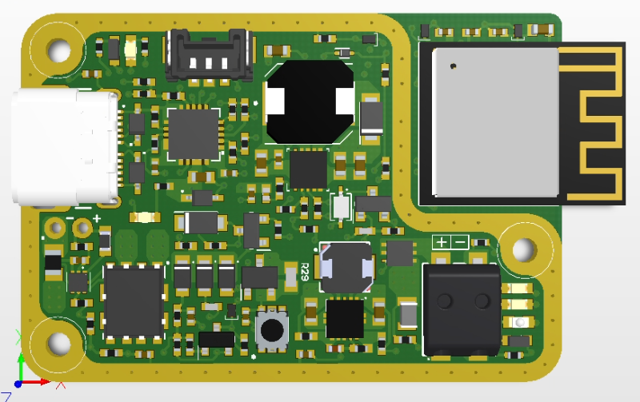
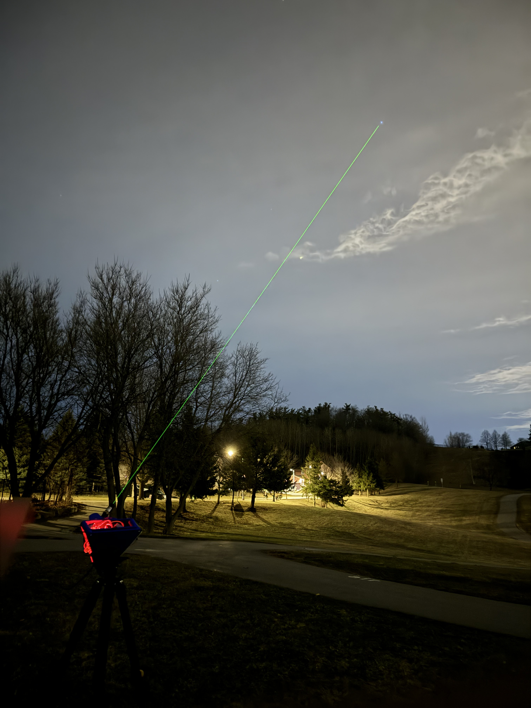

# Adam Abdulahad | Embedded Hardware & Robotics

I'm an Engineering Science student specializing in Robotics at the University of Toronto. I enjoy projects where I can design the electronics, write the firmware, and bring the whole system up on the bench.

[Connect on LinkedIn!](https://www.linkedin.com/in/adampaul04/)

## Selected projects

| Project | What I built |
| --- | --- |
| [Eddie-Node](projects/eddie-node/README.md) | A compact wireless flight controller peripheral. I designed the 8-layer PCB in Altium CircuitStudio, developed the ESP32-H2 firmware, and brought up the board. Includes PCB renders and a battery voltage ADC demo. |
|| 
| [Two-axis star tracker](projects/star-tracker/README.md) | An STM32-controlled pointing mount. I built the mechanical assembly, integrated two stepper motors, and wrote the firmware in C. |
|| 
