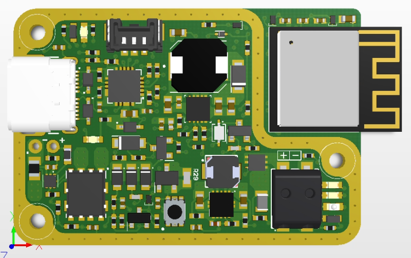
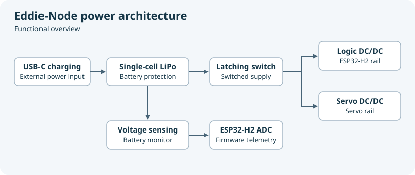
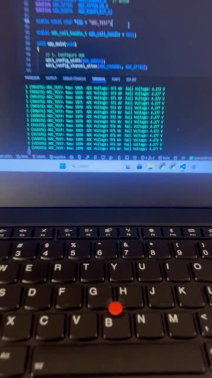

# Eddie-Node | Wireless flight controller peripheral

[Back to portfolio](../../README.md)

Eddie-Node is a compact board that communicates wirelessly with a flight controller to support parachute release and ignition. I owned the electronics and embedded firmware, from schematic and layout through fabrication handoff and bench bring-up.

## What I built

- **PCB:** Designed the schematic and 8-layer layout in **Altium CircuitStudio**. I selected components and prepared the BOM and fabrication files.
- **Power and sensing:** Integrated USB-C charging and protection for a single-cell LiPo, a latching power switch, DC/DC converters for the logic and servo loads, and battery voltage sensing.
- **Firmware and debug:** Wrote C firmware on the ESP32-H2 using FreeRTOS and NimBLE for communication with the flight controller. Routed an impedance-controlled USB differential pair for onboard debugging.

[View the back-side render](media/board-back.png)

## Power architecture

The ESP32-H2 and servo have different supply needs. I used separate DC/DC stages to provide the logic and servo rails from the same battery. The ADC gives the firmware visibility into battery voltage during bring-up and operation.

## Bench validation: battery voltage ADC

This clip shows the assembled board on the bench, followed by the firmware logging raw ADC counts and a converted battery voltage. I used it as a functional check that the sensing path was operating and the firmware could report a voltage.

[Open the ADC bench demo (MP4)](media/battery-adc-demo.mp4)
