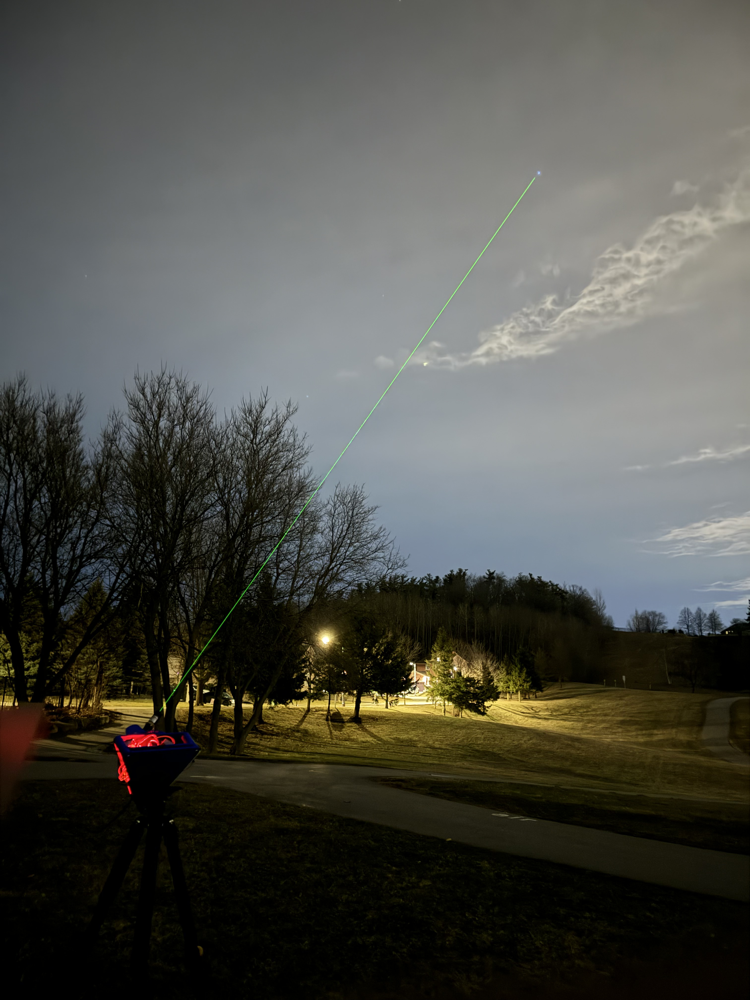

# Two-axis star tracker | STM32 pointing mount

[Back to portfolio](../../README.md)

I built this because I wanted a more direct way to find celestial objects in the night sky. I could look up an object's coordinates, but I still had to work out where to look. The mount uses two stepper motors and an STM32 to point a laser in the direction of a selected object.

## What I built

- Designed (SolidWorks), 3D printed, and assembled a custom mount with two motorized axes compatible with an existing tripod mount.
- Integrated the control electronics and stepper motors for open-loop control of each axis.
- Wrote STM32 firmware in C to turn a target's right ascension and declination into motion on the two axes.
- Given the current time, GPS location, and celestial target, a high power laser pointer gives direct attention to the queried celestial target in the sky.

## What I tested

I field-tested the assembled system to check that the firmware and mechanical axes worked together. This was a pointing prototype: the goal was to direct attention toward a selected object in the sky. Testing was done sufficiently far away from airports, in compliance with laser-pointer laws in Ontario.

